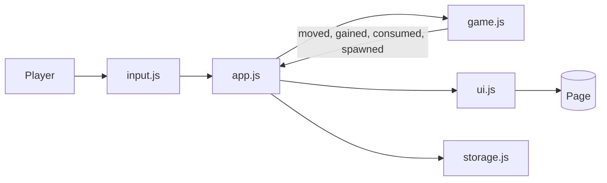

# 🔢 2048

A smooth, dependency-free **2048** puzzle game built with vanilla **HTML, CSS and JavaScript**. Slide the tiles, merge the matching numbers and try to reach **2048**. It has sliding, merging and popping tile animations, undo, a saved best score, an auto-saved game, swipe and keyboard controls, and a unit-tested game engine.

No frameworks, no build step, no images and no network access: the whole game works offline.

---

## Table of Contents

1. [Features](#features)
2. [How to Play](#how-to-play)
3. [Controls](#controls)
4. [Tech Stack](#tech-stack)
5. [Project Structure](#project-structure)
6. [Getting Started](#getting-started)
7. [Architecture](#architecture)
8. [How the Rules Work](#how-the-rules-work)
9. [How the Animations Work](#how-the-animations-work)
10. [Configuration](#configuration)
11. [Accessibility](#accessibility)
12. [Testing](#testing)
13. [Deploying to GitHub Pages](#deploying-to-github-pages)
14. [Browser Support and Known Limitations](#browser-support-and-known-limitations)
15. [Commit History Guide](#commit-history-guide)
16. [Roadmap](#roadmap)
17. [Contributing](#contributing)
18. [License](#license)

---

## Features

- Classic 4×4 **2048** gameplay with correct merge rules
- Smooth animations: tiles **slide**, merged tiles **pop** and new tiles **appear**
- **Undo** for up to 10 moves
- **Best score** saved in your browser, plus a floating `+N` when tiles merge
- **Your game is saved automatically**: close the tab and carry on later
- **Win screen** at 2048 with a **Keep going** option, and a **Game over** screen
- Arrow keys, `WASD`, **swipe** on touch screens, and mouse **drag**
- Responsive: the board scales to any screen width
- Screen-reader friendly: the board is described in words and scores are announced
- Respects `prefers-reduced-motion`
- A game engine with no DOM code, covered by unit tests

---

## How to Play

Slide all the tiles in one direction. Tiles with the **same number merge** into one tile with double the value. After every move a new tile (a 2, or sometimes a 4) appears. Reach the **2048** tile to win, then keep playing for a higher score if you like. The game ends when the board is full and no merges are possible.

### Tips

- Keep your biggest tile in a corner and build next to it
- Work in one or two directions and avoid the opposite one
- Use **Undo** to take back a mistake (up to 10 moves)

---

## Controls

| Action              | Keyboard                      | Touch / Mouse           |
| ------------------- | ----------------------------- | ----------------------- |
| Move tiles          | Arrow keys or `W` `A` `S` `D` | Swipe or drag the board |
| Undo                | `U`                           | **Undo** button         |
| New game            |                               | **New game** button     |

---

## Tech Stack

| Layer       | Technology                                  |
| ----------- | ------------------------------------------- |
| Markup      | HTML5 (semantic elements, ARIA attributes)  |
| Styling     | CSS3 (custom properties, grid, transitions) |
| Logic       | Vanilla JavaScript (ES2015+)                |
| Persistence | Web Storage API (`localStorage`)            |
| Testing     | Node.js built-in test runner (`node:test`)  |

---

## Project Structure

```
game-2048/
├── index.html           # Page structure: scores, board, overlay, controls
├── css/
│   ├── style.css        # Theme, header, scores, buttons
│   └── tiles.css        # Board, tiles, colors, animations, overlay
├── js/
│   ├── config.js        # Board size, win tile, timings, storage keys
│   ├── game.js          # The rules: slide, merge, spawn, win, undo (pure logic)
│   ├── storage.js       # Safe localStorage for best score and saved game
│   ├── ui.js            # All DOM updates and tile animation
│   ├── input.js         # Keyboard, swipe and drag handling
│   ├── app.js           # Controller that connects everything
│   └── main.js          # Entry point
├── tests/
│   ├── game.test.js
│   └── storage.test.js
├── package.json
├── .gitignore
└── README.md
```

---

## Getting Started

### Prerequisites

- Any modern web browser
- (Optional) [Node.js](https://nodejs.org/) 18 or newer, only needed to run the tests

### Run the game

```bash
git clone https://github.com/<your-username>/game-2048.git
cd game-2048
```

Then open `index.html`:

```bash
# Windows
start index.html
# macOS
open index.html
# Linux
xdg-open index.html
```

You can also use the VS Code **Live Server** extension, or any static server such as `python -m http.server 8000`.

---

## Architecture

The rules of the game know nothing about the page, and the page knows nothing about the rules.

| Module       | Responsibility                                   | Touches the DOM? |
| ------------ | ------------------------------------------------ | ---------------- |
| `config.js`  | Constants                                        | No               |
| `game.js`    | Rules, state, undo, save and restore             | No               |
| `storage.js` | Validate, load and save best score and game      | No               |
| `ui.js`      | Draw tiles, scores and messages                  | Yes              |
| `input.js`   | Turn events into `onMove` and `onUndo`           | Yes              |
| `app.js`     | Decide what happens, tell the UI what to draw    | Via `ui.js`      |
| `main.js`    | Create objects and attach listeners              | Yes              |

Each file is wrapped in an IIFE and exports through `module.exports` (Node) or the `window.Game2048` namespace (browser). This avoids ES modules, which browsers block when a page is opened from `file://`.

### Data flow



---

## How the Rules Work

### Sliding and merging

A move works on one row or column at a time (`lineCoords` in `game.js`). The cells of a line are listed **starting at the wall the tiles move towards**, so one routine handles all four directions:

1. Take the tiles of the line in that order, skipping empty cells.
2. Walk through them. If a tile and the next one have the **same value**, they merge into one tile at the next free spot. Otherwise the tile just moves to the next free spot.

This gives the correct classic behaviour:

| Line before | Move left | Why                                              |
| ----------- | --------- | ------------------------------------------------ |
| `2 2 2 2`   | `4 4 . .` | Two merges, each tile merges only once           |
| `2 2 2 .`   | `4 2 . .` | The pair nearest the wall merges first           |
| `4 2 2 .`   | `4 4 . .` | The new 4 does not merge again in the same move  |

### Plan first, then apply

`move()` first works out the whole move without touching the board. If nothing would change (no tile moves and no merges), it returns `moved: false` and does **nothing**: no new tile, no undo entry. Only a real move is applied.

### Spawning

After a move, a **2** (90%) or a **4** (10%) appears on a random empty cell.

### Winning and losing

- Making a tile equal to the win tile (2048) sets `won`. The board then stays locked until the player chooses **Keep going**.
- The game is over when the board has no empty cell **and** no two equal tiles are neighbours (`canMove()`).

### Undo and saving

Before every real move the game stores a snapshot (`toState()`), up to 10 of them. `undo()` restores the last snapshot. The saved game uses the same snapshot format. When a saved game is loaded, `sanitizeState()` checks every tile (valid power of two, on the board, no two on one cell) and returns `null` for anything suspicious, so corrupt data simply starts a new game.

---

## How the Animations Work

Every tile has a unique **id** that stays the same while it slides.

- The screen keeps one `<div>` per tile id. To move a tile, the script only changes its `--r` and `--c` numbers. The CSS `transition` on `transform` makes it **slide**.
- When two tiles merge, both slide into the same cell and are removed after the slide finishes. At the same moment a **new tile** with a new id and double the value is created.
- New and merged tiles use CSS animations with a **delay equal to the slide time**, so they only appear after the sliding stops.
- The tile's number lives in an inner element, so the "pop" and "appear" animations never fight with the position transform.
- After an **undo**, a **new game** or a **page reload**, tiles are simply drawn in place with no animation.
- With `prefers-reduced-motion`, the slide time is set to 0 and the keyframe animations are turned off.

---

## Configuration

Everything adjustable is in `js/config.js`:

| Setting             | Default | Description                                         |
| ------------------- | ------- | --------------------------------------------------- |
| `SIZE`              | `4`     | Board is `SIZE × SIZE`                              |
| `WIN_TILE`          | `2048`  | Tile value that wins the game                       |
| `SPAWN_FOUR_CHANCE` | `0.1`   | Chance that a new tile is a 4                       |
| `UNDO_LIMIT`        | `10`    | Moves that can be undone                            |
| `SWIPE_THRESHOLD`   | `24`    | Pixels a swipe must travel                          |
| `MOVE_MS`           | `120`   | Slide animation time in milliseconds                |
| `OVERLAY_DELAY_MS`  | `500`   | Wait before showing the win or game-over message    |

---

## Accessibility

- The board has a spoken description ("Row 1: 2, empty, 4, empty ...") that updates after every move
- Scores are announced through a polite live region
- The win and game-over message is a dialog and moves keyboard focus to its primary button
- Full keyboard play, and visible focus rings
- Tile colors have enough contrast, and every tile shows its number
- `prefers-reduced-motion` is respected

---

## Testing

The game engine and storage are covered by unit tests using Node's built-in test runner, so there is nothing to install:

```bash
npm test
```

(or simply `node --test`)

| Test file          | What it covers                                                                              |
| ------------------ | ------------------------------------------------------------------------------------------- |
| `game.test.js`     | Sliding in all directions, merge rules, scoring, spawning, no-op moves, game over, winning, undo and its limit, saving and restoring, rejecting corrupt data |
| `storage.test.js`  | Best score and saved game round trips, invalid and corrupt data, missing storage            |

### The random-play test

One test plays **300 random moves** and checks after every move that the **total of all tile values equals the starting total plus everything that spawned**. Merging must never create or destroy value, so any bug in the slide or merge code would break this check. It also checks that two tiles never share a cell.

### Debugging in the browser

```js
game2048.game.toGrid()     // the board as rows of numbers
game2048.game.score
game2048.game.history.length
```

---

## Deploying to GitHub Pages

Because this is a static site, deployment is free:

1. Push the repository to GitHub.
2. Go to **Settings → Pages**.
3. Under **Build and deployment**, choose **Deploy from a branch**.
4. Select the `main` branch and the `/ (root)` folder, then save.
5. After a minute the game is live at `https://<your-username>.github.io/game-2048/`.

---

## Browser Support and Known Limitations

Works in current versions of Chrome, Edge, Firefox and Safari on desktop and mobile. It needs ES2015 classes, CSS custom properties, `calc()` with variables and pointer events. The game still runs without `localStorage`, it just cannot remember anything.

- Undo history is kept only while the page is open. A saved game restores the board and score, but not the undo steps.
- The board is a fixed 4×4 (the code supports other sizes through `SIZE`, but the styling is tuned for 4×4).

---

## Commit History Guide

The project was built module by module, one commit per step:

| #  | Type    | What it added                                                       |
| -- | ------- | ------------------------------------------------------------------- |
| 1  | `chore` | Repository initialization, `.gitignore` and `package.json`          |
| 2  | `docs`  | Initial README skeleton                                             |
| 3  | `feat`  | HTML structure: scores, board, overlay, controls                    |
| 4  | `style` | Theme, header, score boxes and buttons                              |
| 5  | `style` | Board, sliding tiles, colors, animations and overlay                |
| 6  | `feat`  | Game configuration                                                  |
| 7  | `feat`  | Game rules: slide, merge, spawn, win, game over, undo, saving       |
| 8  | `test`  | Unit tests for the game rules                                       |
| 9  | `feat`  | Safe `localStorage` for best score and saved game, with tests       |
| 10 | `feat`  | UI module with id-based tile animation                              |
| 11 | `feat`  | Keyboard, swipe and drag input                                      |
| 12 | `feat`  | App controller and entry point                                      |
| 13 | `docs`  | This detailed README                                                |

Commit messages follow the [Conventional Commits](https://www.conventionalcommits.org/) style.

---

## Roadmap

- [ ] Selectable board sizes (3×3, 5×5, 6×6)
- [ ] Persisted undo history
- [ ] Sound effects with a mute toggle
- [ ] Light theme
- [ ] Hint that suggests a good move
- [ ] Installable PWA with offline support

---

## Contributing

Contributions are welcome.

1. Fork the repository
2. Create a feature branch: `git checkout -b feat/my-feature`
3. Make your changes and run `npm test`
4. Commit with a clear message: `git commit -m "feat: describe your change"`
5. Push and open a Pull Request

---

## License

This project does not include a license file, all rights are reserved.
